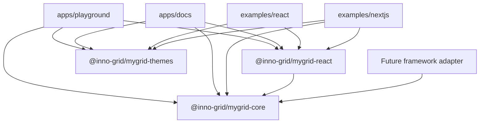

# Architecture

MyGrid is split so that grid behavior can exist without a UI framework, and so that more than one framework can sit on top of the same core later. This document describes the foundation. It does not describe a grid runtime, because that runtime is not built.

## Package graph



Allowed dependencies:

| Package                    | May depend on                                                                                       |
| -------------------------- | --------------------------------------------------------------------------------------------------- |
| `@inno-grid/mygrid-core`   | Nothing inside this repo. No React.                                                                 |
| `@inno-grid/mygrid-themes` | Nothing inside this repo.                                                                           |
| `@inno-grid/mygrid-react`  | `@inno-grid/mygrid-core` at runtime. React 19 as a peer. Themes only as a Storybook dev dependency. |
| Apps and examples          | The publishable packages they actually import.                                                      |

Core logic stays in `@inno-grid/mygrid-core`. The React package adapts that core to React. Today the core exports a library name, a version, and `defineGridAdapter`. The React package calls `defineGridAdapter` and renders a mount node. Neither side implements columns, rows, sorting, filtering, selection, editing, or virtualization.

A future adapter, for example a Vue package, would be a new workspace package that depends on core and not on `@inno-grid/mygrid-react`. That package is not created in this foundation.

## Module initialization

Library modules must not read `window`, `document`, `localStorage`, `sessionStorage`, or `navigator` while the module evaluates. Host applications, including the Next.js server runtime, import these modules during startup.

How that is kept true:

- `@inno-grid/mygrid-core` and `@inno-grid/mygrid-themes` extend a TypeScript config whose `lib` is `ES2023` only. The DOM type library is not included, so a stray `window` reference fails typechecking.
- `scripts/check-foundation.mjs` walks the package sources and fails if those globals appear outside a function.
- `apps/playground/scripts/verify-packages.mjs` imports the built packages in Node, where `window` is absent.

Reading the DOM inside a function that runs after mount is a host concern. The playground reads computed theme tokens while it renders. The packages do not.

## React and Next.js

`@inno-grid/mygrid-react` is ESM. Its source entry and the built `dist/index.js` start with `'use client'`. A Next.js App Router Server Component can import `MyGrid` and treat that import as the client boundary. `examples/nextjs` does this: the page reads `@inno-grid/mygrid-core` on the server and renders `MyGrid` from the React package.

The React package does not import the theme. CSS is a side effect, and server rendering should not pull a stylesheet just because a component was imported. Hosts opt in:

```ts
import '@inno-grid/mygrid-themes/theme.css';
```

The published React peer range is React 19, which is the version this repo installs and tests. React 18 is not claimed.

## Themes

The default stylesheet is one import:

```ts
import '@inno-grid/mygrid-themes/theme.css';
```

That file is the concatenation of four sources, in cascade order:

| Source          | What it sets                                                       |
| --------------- | ------------------------------------------------------------------ |
| `light.css`     | Default colors on `:root` and `[data-mygrid-theme="light"]`.       |
| `dark.css`      | Color overrides on `[data-mygrid-theme="dark"]`.                   |
| `density.css`   | Spacing and type size for `compact`, `default`, and `comfortable`. |
| `structure.css` | Rules for `[data-mygrid]` that only _use_ the custom properties.   |

`light.css`, `dark.css`, and `density.css` are also package exports, so a host can import one of them. `theme.css` is the entry that includes every foundation. The default color theme is light. The default density is `default`, set on `:root`, so a mount with no density attribute still has spacing.

`MyGrid` sets `data-mygrid-theme` and `data-mygrid-density` only when the matching prop is passed. It does not import the stylesheet. Color variables are not declared on `[data-mygrid]` itself, so a `dark` attribute on that same element is not overwritten by the structural rule.

`themeTokens` lists every `--mygrid-*` custom property. A unit test fails if the CSS sources and that map drift. `themeNames` and `densityNames` are the public name lists. The React prop unions are checked against those lists by the playground typecheck.

These foundations style the mount shell. They do not style cells, headers, or rows, because those elements do not exist yet. The selectors do not imitate another product's theme.

## Public output

Each publishable package is built with Vite in library mode, ES2023, ESM only. Minification is off so the published JavaScript stays readable; source maps are still emitted. `vite-plugin-dts` writes declarations from `tsconfig.build.json`. `main`, `module`, and `types` point at `dist`, and `exports` adds a `default` condition beside `import` and `types`. `files` is `["dist"]`. There is no CommonJS build. Each package has `build`, `test`, `typecheck`, and `clean`. The root package stays private and runs those four through Turborepo.

`@inno-grid/mygrid-themes` emits `dist/theme.css`, `dist/light.css`, `dist/dark.css`, and `dist/density.css`. The JavaScript entry does not import those files. `sideEffects` is `false` on core and React. The themes package lists the CSS files in `sideEffects` so a bundler keeps a stylesheet import.

`apps/playground/src/package-consumer.ts` imports core, the React component types, the theme names, and every CSS export. `apps/playground/scripts/verify-packages.mjs` imports the built packages from Node and checks that core does not reference React, that the React bundle imports core, that the CSS exports resolve, and that the `.d.ts` files sit beside the JavaScript. `pnpm test` runs that script after the unit tests. Nothing publishes to npm.

## Toolchain

pnpm workspaces and a shared catalog pin toolchain versions. Turborepo orders tasks so a package build runs before dependents typecheck, test, or start. Vitest runs unit tests. Storybook builds the React mount stories. Playwright runs the playground in Chromium. Changesets versions the three linked public packages together.

Apps and examples are private and ignored by Changesets. The root package is private. The three libraries are not marked `"private": true`, and each has `"publishConfig": { "access": "public" }`.

## What a later grid feature must respect

When grid behavior is added:

1. Put the model and the behavior in `@inno-grid/mygrid-core`, still without reading browser globals at module scope.
2. Teach `@inno-grid/mygrid-react` to render the result of that core. Do not reimplement the behavior in React.
3. Put visual decisions in `@inno-grid/mygrid-themes`.
4. Keep the Next.js example importing core from a Server Component and the React entry as a client boundary.
5. Add the same behavior to a future adapter only through the core, not by importing the React package.
