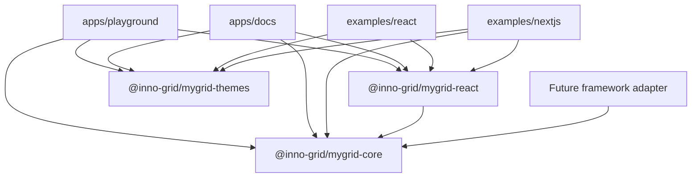

# Architecture

MyGrid is split so that grid behavior can exist without a UI framework, and so that more than one framework can sit on top of the same core later. The core package holds an in-memory grid engine. The React package creates that engine and renders the current page as a table.

## Package graph



Allowed dependencies:

| Package                    | May depend on                                                                                       |
| -------------------------- | --------------------------------------------------------------------------------------------------- |
| `@inno-grid/mygrid-core`   | Nothing inside this repo. No React.                                                                 |
| `@inno-grid/mygrid-themes` | Nothing inside this repo.                                                                           |
| `@inno-grid/mygrid-react`  | `@inno-grid/mygrid-core` at runtime. React 19 as a peer. Themes only as a Storybook dev dependency. |
| Apps and examples          | The publishable packages they actually import.                                                      |

Core logic stays in `@inno-grid/mygrid-core`. The React package adapts that core to React. The core exports a library name, a version, `defineGridAdapter`, and the engine created by `createGrid`. The React package calls `defineGridAdapter` and `createGrid`. It renders headers, the current page of rows, and field values. It does not reimplement sorting, filtering, pagination, or selection. Row and column virtualization live in the React view. Grouping, pivoting, and editing are not implemented.

A future adapter, for example a Vue package, would be a new workspace package that depends on core and not on `@inno-grid/mygrid-react`. That package is not created in this foundation.

## Core engine

`createGrid` builds a framework-free grid from column definitions and optional row data. The engine does not read the DOM and does not import React. Host context and `getRowId` stay on the instance. They are not part of the serializable snapshot.

The pieces are:

| Module       | Responsibility                                                                                                        |
| ------------ | --------------------------------------------------------------------------------------------------------------------- |
| Column model | Validates definitions, assigns column ids, and keeps runtime width, visibility, and pin separate from the definition. |
| Row model    | Stores rows, assigns stable ids, and applies insert, remove, replace, and transactions without partial writes.        |
| State        | Holds one frozen snapshot and notifies subscribers only when the snapshot's values change.                            |
| Events       | Emits the nine grid events. One throwing listener does not skip the others.                                           |
| Sorting      | Orders the rows that pass the filter. Source row objects and source order stay unchanged.                             |
| Filtering    | Keeps the source rows that match the filter model. Sorting then orders that subset.                                   |
| Pagination   | Reads a zero-based page of the filtered, sorted rows. The full displayed list stays available.                        |
| Selection    | Stores source row ids. Modes are none, single, and multiple. Page changes do not clear them.                          |
| Persistence  | Writes and reads version 1 JSON. Functions, class instances, and cycles are rejected.                                 |

`GridApi.getDisplayedRowCount` returns the rows that pass the filters, after sorting. `getFilteredRowCount` is that same count. Pagination is a window over that list and does not change either count or `getRowNodeAtIndex`. `refreshCells` reads current field values for a future view. It does not paint and it does not emit an event.

Row identity is `getRowId` when the host supplied one. Otherwise it is an own `id` string or finite number. Otherwise the engine generates `row:N` and remembers it for that object. Generated ids are not reused after a row is removed. `serializeGridState` writes those ids. `restoreGridState` checks them again, and a snapshot whose ids came from `getRowId` must be restored with that same function.

Column order is definition order. Column state can change width, `hide`, and pin. It cannot reorder columns. `sortable` allows the column to enter the sort model. `filterable` allows the column to enter the filter model. A hidden column can still be sorted or filtered.

Displayed rows are the source rows that pass every active filter when `join` is `and`, or any active filter when `join` is `or`, then ordered by the sort model. With no filters, every source row is eligible. `rowData` and `rowIds` stay in source order. The caller's array is not reordered or resized. `getRowNodeAtIndex` and the focused cell use the displayed order. `getRowNode` returns a displayed row, so a filtered-out row is absent there and still present in the source snapshot.

Sorting reads the field on each eligible row, or a column `comparator` when one is set. There is no value getter. The comparator returns an ascending comparison and is not written into the snapshot. Equal values keep their source order. `null`, `undefined`, `NaN`, and invalid dates stay after defined values in both directions. String sorting is case-sensitive unless the grid `sorting.caseSensitive` option or the column `caseSensitive` flag says otherwise. `clearSort` restores source order inside the current filtered subset. `sortChanged` is emitted when the sort model changes, or when `applySorting` changes the displayed ids without a filter-model change. An equal sort model does not emit. Transaction `addIndex` is a source index.

Filtering reads the same field. A column `filter` function is used only when that column's model is `{ filterType: "custom" }`. The function is not written into the snapshot. Text operators are `contains`, `notContains`, `equals`, `notEqual`, `startsWith`, and `endsWith`. Blank values fail the positive operators and pass the two negative ones. An empty string is not blank. Number operators are `equals`, `notEqual`, `greaterThan`, `greaterThanOrEqual`, `lessThan`, `lessThanOrEqual`, and inclusive `inRange`. Only finite numbers pass, so blanks fail `notEqual` as well. Date operators are `equals`, `before`, `after`, and inclusive `inRange`, compared as UTC calendar days. A cell may be a `Date`, a finite timestamp, or `YYYY-MM-DD`. A set filter matches the listed strings, finite numbers, and booleans. `null` in the set also matches `undefined`. An empty set matches no rows. Conditions inside one column use that filter's `operator`, which defaults to `and`. Text case comes from the filter when set, otherwise from `filtering.caseSensitive`, which defaults to true. `filterChanged` is emitted when the filter model changes, or when `applyFilters` changes the displayed ids. An equal filter model does not emit. Adding, removing, or replacing rows recomputes the display and emits `rowDataChanged`.

`setGridState` keeps a comparator or filter predicate that is already on the live column when the snapshot does not carry one, then checks that the filter and sort models reproduce `displayedRowIds`. A focused row that is filtered out loses focus. Selected ids remain, because the row is still in the source. A page index that the restored rows cannot show is rejected. A snapshot that omits `pagination` restores with pagination disabled, page 0, and a page size of 100.

Pagination runs after filtering and sorting. Page indexes are zero-based. It is disabled unless `pagination.enabled` is true, so an existing grid still shows every filtered row on page 0. The default page size is 100 and the default size options are 10, 25, 50, and 100. `getPaginatedRowCount` and `getRowNodeAtPageIndex` address the current page. `setPage` rejects an index past the last page. `nextPage`, `previousPage`, `firstPage`, and `lastPage` do not emit when the page stays put. A filter, sort, or row edit that leaves the current page past the end moves to the last valid page and emits `paginationChanged`. `clearAllFilters` keeps the sort model. `clearSort` keeps the filter model. An empty filtered set has page count 0 and stays on page 0.

Selection ids are source row ids. The default mode is `multiple`. `single` keeps one id, and a later `selectRow` replaces it. `none` rejects a non-empty selection. `selectAllFilteredRows` replaces the selection with every row that passes the current filters, in displayed order, on every page. `selectAllSourceRows` replaces it with every source id, including rows the filter hides. Sorting, paging, and filtering do not clear a selection. Removing a source row drops its id. Replacing a row with the same id keeps the selection. An unknown id throws from the mutating calls and returns false from `isRowSelected`. An unchanged selection or page does not emit.

Selected row ids and the focused cell live in the snapshot. The React grid draws a checkbox column from those ids when selection is not `none`. There is no spreadsheet keyboard navigation.

A listener or state subscriber must not change the grid while it is running. `destroy` drops listeners and subscribers. Later API calls throw.

## Module initialization

Library modules must not read `window`, `document`, `localStorage`, `sessionStorage`, or `navigator` while the module evaluates. Host applications, including the Next.js server runtime, import these modules during startup.

How that is kept true:

- `@inno-grid/mygrid-core` and `@inno-grid/mygrid-themes` extend a TypeScript config whose `lib` is `ES2023` only. The DOM type library is not included, so a stray `window` reference fails typechecking.
- `scripts/check-foundation.mjs` walks the package sources and fails if those globals appear outside a function.
- `apps/playground/scripts/verify-packages.mjs` imports the built packages in Node, where `window` is absent.

Reading the DOM inside a function that runs after mount is a host concern. The playground reads computed theme tokens while it renders. The packages do not.

## React and Next.js

`@inno-grid/mygrid-react` is ESM. Its source entry and the built `dist/index.js` start with `'use client'`. A Next.js App Router Server Component can import `MyGrid` and treat that import as the client boundary. `examples/nextjs` does this: the page reads `@inno-grid/mygrid-core` on the server and renders `MyGrid` from the React package.

The React package does not import the theme. CSS is a side effect, and server rendering should not pull a stylesheet just because a component was imported. Hosts opt in:

```ts
import '@inno-grid/mygrid-themes/theme.css';
```

`MyGrid` creates one grid when `columnDefs` is set and destroys it on unmount. `rowData` and `columnDefs` are applied to that grid when the prop reference changes. Sorting, filtering, pagination, selection, `getRowId`, and `initialState` are read at creation. Callbacks are stored in a ref so a render does not subscribe again. `onGridReady` receives the core `GridApi`. The table is a native `<table>`. Pinned columns use sticky positioning and stay mounted. The body mounts the rows that overlap the vertical viewport, plus `rowOverscan` (default 6). Unpinned columns that overlap the horizontal viewport are mounted, plus `columnOverscan` (default 2). Top and bottom spacer rows, and left and right spacer cells, keep the scroll size equal to the full page and the full column width. When pagination is enabled, that window is the current page. A page change resets the vertical scroll position. A Next.js Server Component can pass plain column and row values into `MyGrid` because the package entry is the client boundary. Functions such as comparators cannot cross that boundary.

The published React peer range is React 19, which is the version this repo installs and tests. React 18 is not claimed.

## Themes

The default stylesheet is one import:

```ts
import '@inno-grid/mygrid-themes/theme.css';
```

That file is the concatenation of four sources, in cascade order:

| Source          | What it sets                                                       |
| --------------- | ------------------------------------------------------------------ |
| `light.css`     | Default colors on `:root` and `[data-mygrid-theme="light"]`.       |
| `dark.css`      | Color overrides on `[data-mygrid-theme="dark"]`.                   |
| `density.css`   | Spacing and type size for `compact`, `default`, and `comfortable`. |
| `structure.css` | Rules for `[data-mygrid]` that only _use_ the custom properties.   |

`light.css`, `dark.css`, and `density.css` are also package exports, so a host can import one of them. `theme.css` is the entry that includes every foundation. The default color theme is light. The default density is `default`, set on `:root`, so a mount with no density attribute still has spacing.

`MyGrid` sets `data-mygrid-theme` and `data-mygrid-density` only when the matching prop is passed. It does not import the stylesheet. Color variables are not declared on `[data-mygrid]` itself, so a `dark` attribute on that same element is not overwritten by the structural rule.

`themeTokens` lists every `--mygrid-*` custom property. A unit test fails if the CSS sources and that map drift. `themeNames` and `densityNames` are the public name lists. The React prop unions are checked against those lists by the playground typecheck.

These foundations style the mount and the rendered table: header, cells, pinned columns, hover, selected rows, and a filtered-column indicator. The selectors do not imitate another product's theme. `structure.css` only consumes tokens. Row and header heights live in `density.css`.

## Public output

Each publishable package is built with Vite in library mode, ES2023, ESM only. Minification is off so the published JavaScript stays readable; source maps are still emitted. `vite-plugin-dts` writes declarations from `tsconfig.build.json`. `main`, `module`, and `types` point at `dist`, and `exports` adds a `default` condition beside `import` and `types`. `files` is `["dist"]`. There is no CommonJS build. Each package has `build`, `test`, `typecheck`, and `clean`. The root package stays private and runs those four through Turborepo.

`@inno-grid/mygrid-themes` emits `dist/theme.css`, `dist/light.css`, `dist/dark.css`, and `dist/density.css`. The JavaScript entry does not import those files. `sideEffects` is `false` on core and React. The themes package lists the CSS files in `sideEffects` so a bundler keeps a stylesheet import.

`apps/playground/src/package-consumer.ts` imports core, the React component types, the theme names, and every CSS export. `apps/playground/scripts/verify-packages.mjs` imports the built packages from Node and checks that core does not reference React, that the React bundle imports core, that the CSS exports resolve, and that the `.d.ts` files sit beside the JavaScript. `pnpm test` runs that script after the unit tests. `pnpm pack:check` checks the packed archives. Nothing in the test or archive check publishes to npm.

## Toolchain

pnpm workspaces and a shared catalog pin toolchain versions. Turborepo orders tasks so a package build runs before dependents typecheck, test, or start. Vitest runs unit tests. Storybook builds the React mount stories. Playwright runs the playground in Chromium. Changesets versions the three linked public packages together.

Apps and examples are private and ignored by Changesets. The root package is private. The three libraries are not marked `"private": true`, and each has `"publishConfig": { "access": "public" }`.

## What a later grid feature must respect

When grid behavior is added:

1. Put the model and the behavior in `@inno-grid/mygrid-core`, still without reading browser globals at module scope.
2. Teach `@inno-grid/mygrid-react` to render the result of that core. Do not reimplement the behavior in React.
3. Put visual decisions in `@inno-grid/mygrid-themes`.
4. Keep the Next.js example importing core from a Server Component and the React entry as a client boundary.
5. Add the same behavior to a future adapter only through the core, not by importing the React package.
